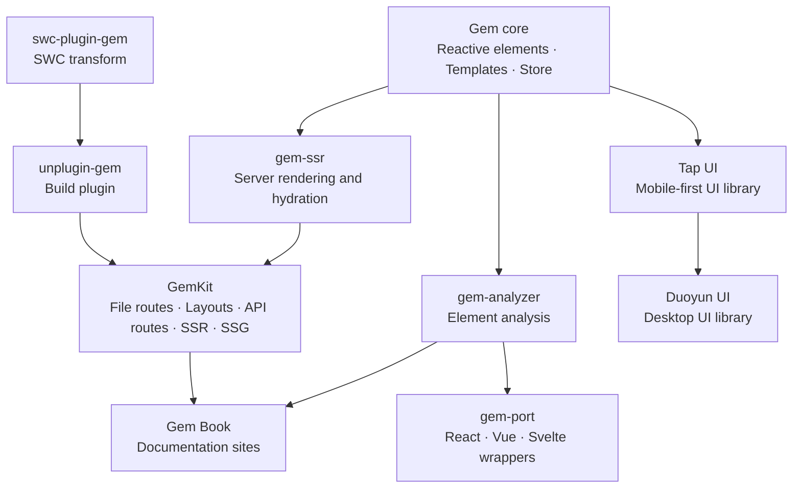

# Gem

Read in other languages: English | [中文](./README_zh.md)

**A Web Components framework and application toolchain.** Build reusable custom elements, UI libraries and complete web apps with browser-native technologies — from small reactive elements to SSR/SSG applications.

## Why Gem

- **Start small, scale up.** Add reactive behavior to a custom element with Gem's decorators and APIs. Use `GemElement` and HTML template rendering when you need a component model.
- **Standards-first components.** Gem elements are native Custom Elements. Use Shadow DOM for isolated components, or Light DOM when app-level CSS integration matters.
- **A path from components to apps.** Use `@mantou/gem` for reactive elements, templates, routing, history and Store. [GemKit](packages/gemkit) builds on Gem with file-based routing, layouts, server data, actions, API routes, i18n, SSR and SSG.
- **Work with the ecosystem you have.** [gem-port](packages/gem-port) generates React, Vue and Svelte wrappers. GemKit is built on [Rsbuild](https://rsbuild.rs).
- **Keep the browser responsive.** `@async()` lets elements render in slices and yield to the main thread.

## Get started with GemKit

Create a full-stack Gem application:

```sh
npm create gemkit@latest my-app
cd my-app
npm install
npm run dev
```

Or start with the [Gem guide](https://gemjs.org/guide/) if you want to build individual custom elements first.

## How the pieces fit together



## Documentation

- [Gem Guide](https://gemjs.org/guide/)
- [Gem API](https://gemjs.org/api/)
- [GemKit Guide](https://gemkit.gemjs.org/en/guide)
- [GemKit Reference](https://gemkit.gemjs.org/en/reference)
- [中文文档](https://gemkit.gemjs.org/zh)

## Ecosystem

| Project | Description |
| --- | --- |
| [Gem](packages/gem) | Core reactive Web Components framework |
| [GemKit](packages/gemkit) | Rsbuild-based application framework: file routing, layouts, server data, actions, API routes, i18n, SSR and SSG |
| [gem-ssr](packages/gem-ssr) | Server rendering and hydration |
| [gem-port](packages/gem-port) | React, Vue and Svelte wrappers for Gem elements |
| [Duoyun UI](packages/duoyun-ui) · [Tap UI](packages/tap-ui) | Desktop and mobile-first UI libraries built with Gem |
| [DevTools](packages/gem-devtools) · [Analyzer](packages/gem-analyzer) | Debugging and component analysis |
| [TypeScript tools](packages/ts-gem-plugin) · [LSP](packages/ts-gem-lsp) | TypeScript language support |
| [unplugin-gem](packages/unplugin-gem) · [swc-plugin-gem](crates/swc-plugin-gem) | Build plugins for Vite/Webpack/Rollup/esbuild/Rspack/Rolldown and SWC |
| [Zed](crates/zed-plugin-gem) · [VS Code](packages/vscode-gem-plugin) | Editor extensions |

[Roadmap](https://mm.tt/app/map/3412316197?t=TGs84FRcwQ).

## Contribution

Fork the repository and open a pull request.
