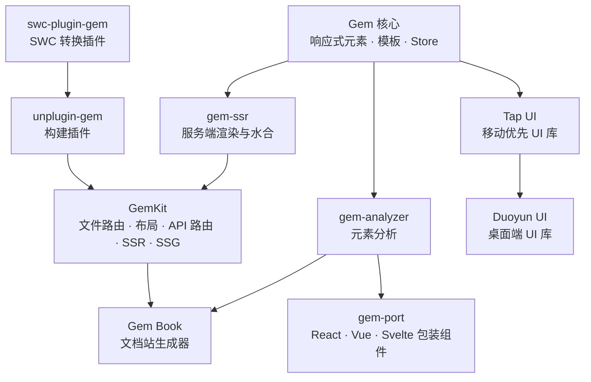

# Gem

使用其他语言阅读：[English](./README.md) | 简体中文

**Web Components 框架与应用工具链。** 使用浏览器原生技术构建可复用的自定义元素、UI 库和完整的 Web 应用——从轻量的响应式元素到 SSR/SSG 应用。

## 为什么选择 Gem

- **从小处开始，按需扩展。** 使用 Gem 的装饰器和 API 为自定义元素添加响应式能力；需要组件模型时再使用 `GemElement` 和 HTML 模板渲染。
- **标准优先的组件。** Gem 元素就是原生自定义元素。需要样式隔离时使用 Shadow DOM，需要与应用级 CSS 集成时使用 Light DOM。
- **从组件到应用的完整路径。** `@mantou/gem` 提供响应式元素、模板、路由、history 和 Store；[GemKit](packages/gemkit) 在 Gem 之上提供文件路由、布局、服务端数据、表单 actions、API 路由、i18n、SSR 和 SSG。
- **融入现有生态。** [gem-port](packages/gem-port) 可生成 React、Vue 和 Svelte 包装组件；GemKit 基于 [Rsbuild](https://rsbuild.rs) 构建。
- **保持界面响应。** `@async()` 让元素分片渲染，并让出主线程。

## 使用 GemKit 快速开始

创建一个全栈 Gem 应用：

```sh
npm create gemkit@latest my-app
cd my-app
npm install
npm run dev
```

如果想先从单个自定义元素开始，请阅读 [Gem 指南](https://gemjs.org/guide/)。

## 各部分如何协作



## 文档

- [Gem 指南](https://gemjs.org/guide/)
- [Gem API](https://gemjs.org/api/)
- [GemKit 指南](https://gemkit.gemjs.org/zh/guide)
- [GemKit 参考](https://gemkit.gemjs.org/zh/reference)

## 生态

| 项目                                                                            | 描述                                                                                          |
| ------------------------------------------------------------------------------- | --------------------------------------------------------------------------------------------- |
| [Gem](packages/gem)                                                             | 核心响应式 Web Components 框架                                                                |
| [GemKit](packages/gemkit)                                                       | 基于 Rsbuild 的应用框架：文件路由、布局、服务端数据、表单 actions、API 路由、i18n、SSR 和 SSG |
| [gem-ssr](packages/gem-ssr)                                                     | 服务端渲染与水合                                                                              |
| [gem-port](packages/gem-port)                                                   | 为 Gem 元素生成 React、Vue 和 Svelte 包装组件                                                 |
| [Duoyun UI](packages/duoyun-ui) · [Tap UI](packages/tap-ui)                     | 使用 Gem 构建的桌面端和移动优先 UI 库                                                         |
| [DevTools](packages/gem-devtools) · [Analyzer](packages/gem-analyzer)           | 调试与组件分析                                                                                |
| [TypeScript 插件](packages/ts-gem-plugin) · [LSP](packages/ts-gem-lsp)          | TypeScript 语言支持                                                                           |
| [unplugin-gem](packages/unplugin-gem) · [swc-plugin-gem](crates/swc-plugin-gem) | 构建插件，支持 Vite/Webpack/Rollup/esbuild/Rspack/Rolldown 和 SWC                             |
| [Zed](crates/zed-plugin-gem) · [VS Code](packages/vscode-gem-plugin)            | 编辑器扩展                                                                                    |

[路线图](https://mm.tt/app/map/3412316197?t=TGs84FRcwQ)。

## 贡献

Fork 项目并提交 PR。
